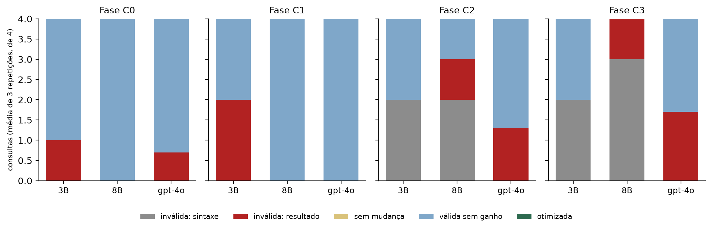
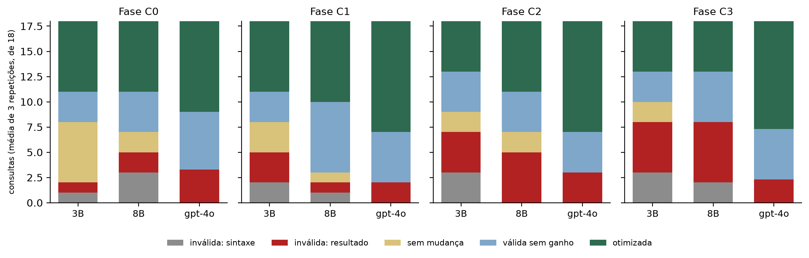

# Conjunto final: cinco categorias por execucao, custo estimado como criterio de ganho

Media = media das tres repeticoes; soma = soma das tres. Erros de execucao (estouro de 5 min ou de disco) contam em `invalida_sintaxe`.

## Cenario 1: TPC-H (144 execucoes)

### Fase C0

Pressuposto: partida fria: o modelo recebe apenas a consulta, sem esquema, sem estatisticas e sem memoria de execucoes anteriores.

| modelo | invalida_sintaxe | invalida_resultado | sem_mudanca | valida_sem_ganho | otimizada | de |
|---|---|---|---|---|---|---|
| llama3.2 (3B) | 0.0 | 1.0 | 0.0 | 3.0 | 0.0 | 4 |
| llama3 (8B) | 0.0 | 0.0 | 0.0 | 4.0 | 0.0 | 4 |
| gpt-4o | 0.0 | 0.7 | 0.0 | 3.3 | 0.0 | 4 |

### Fase C1

Pressuposto: o modelo recebe a consulta mais o esquema das tabelas e o numero de linhas de cada uma.

| modelo | invalida_sintaxe | invalida_resultado | sem_mudanca | valida_sem_ganho | otimizada | de |
|---|---|---|---|---|---|---|
| llama3.2 (3B) | 0.0 | 2.0 | 0.0 | 2.0 | 0.0 | 4 |
| llama3 (8B) | 0.0 | 0.0 | 0.0 | 4.0 | 0.0 | 4 |
| gpt-4o | 0.0 | 0.0 | 0.0 | 4.0 | 0.0 | 4 |

### Fase C2

Pressuposto: o modelo recebe, alem do esquema e dos tamanhos, um catalogo de transformacoes classicas de reescrita.

| modelo | invalida_sintaxe | invalida_resultado | sem_mudanca | valida_sem_ganho | otimizada | de |
|---|---|---|---|---|---|---|
| llama3.2 (3B) | 2.0 | 0.0 | 0.0 | 2.0 | 0.0 | 4 |
| llama3 (8B) | 2.0 | 1.0 | 0.0 | 1.0 | 0.0 | 4 |
| gpt-4o | 0.0 | 1.3 | 0.0 | 2.7 | 0.0 | 4 |

### Fase C3

Pressuposto: o modelo recebe, alem de tudo isso, o plano de execucao estimado da consulta original.

| modelo | invalida_sintaxe | invalida_resultado | sem_mudanca | valida_sem_ganho | otimizada | de |
|---|---|---|---|---|---|---|
| llama3.2 (3B) | 2.0 | 0.0 | 0.0 | 2.0 | 0.0 | 4 |
| llama3 (8B) | 3.0 | 1.0 | 0.0 | 0.0 | 0.0 | 4 |
| gpt-4o | 0.0 | 1.7 | 0.0 | 2.3 | 0.0 | 4 |

### Cinco categorias, soma das 3 repeticoes

| modelo | config | invalida_sintaxe | invalida_resultado | sem_mudanca | valida_sem_ganho | otimizada | n | erros_execucao (dentro de invalida_sintaxe) | de |
|---|---|---|---|---|---|---|---|---|---|
| llama3.2 (3B) | C0 | 0 | 3 | 0 | 9 | 0 | 12 | 0 | 12 |
| llama3.2 (3B) | C1 | 0 | 6 | 0 | 6 | 0 | 12 | 0 | 12 |
| llama3.2 (3B) | C2 | 6 | 0 | 0 | 6 | 0 | 12 | 3 | 12 |
| llama3.2 (3B) | C3 | 6 | 0 | 0 | 6 | 0 | 12 | 0 | 12 |
| llama3 (8B) | C0 | 0 | 0 | 0 | 12 | 0 | 12 | 0 | 12 |
| llama3 (8B) | C1 | 0 | 0 | 0 | 12 | 0 | 12 | 0 | 12 |
| llama3 (8B) | C2 | 6 | 3 | 0 | 3 | 0 | 12 | 0 | 12 |
| llama3 (8B) | C3 | 9 | 3 | 0 | 0 | 0 | 12 | 0 | 12 |
| gpt-4o | C0 | 0 | 2 | 0 | 10 | 0 | 12 | 0 | 12 |
| gpt-4o | C1 | 0 | 0 | 0 | 12 | 0 | 12 | 0 | 12 |
| gpt-4o | C2 | 0 | 4 | 0 | 8 | 0 | 12 | 0 | 12 |
| gpt-4o | C3 | 0 | 5 | 0 | 7 | 0 | 12 | 0 | 12 |

### Otimizada (custo) x otimizada e tempo >= 1,15 x so tempo (media de 3 repeticoes)

| modelo | config | otimizada (custo) | otimizada E tempo >= 1,15 | tempo >= 1,15 (so tempo) | de |
|---|---|---|---|---|---|
| llama3.2 (3B) | C0 | 0.0 | 0.0 | 0.0 | 4 |
| llama3.2 (3B) | C1 | 0.0 | 0.0 | 0.0 | 4 |
| llama3.2 (3B) | C2 | 0.0 | 0.0 | 0.0 | 4 |
| llama3.2 (3B) | C3 | 0.0 | 0.0 | 0.0 | 4 |
| llama3 (8B) | C0 | 0.0 | 0.0 | 0.3 | 4 |
| llama3 (8B) | C1 | 0.0 | 0.0 | 0.0 | 4 |
| llama3 (8B) | C2 | 0.0 | 0.0 | 0.0 | 4 |
| llama3 (8B) | C3 | 0.0 | 0.0 | 0.0 | 4 |
| gpt-4o | C0 | 0.0 | 0.0 | 0.0 | 4 |
| gpt-4o | C1 | 0.0 | 0.0 | 0.0 | 4 |
| gpt-4o | C2 | 0.0 | 0.0 | 0.0 | 4 |
| gpt-4o | C3 | 0.0 | 0.0 | 0.0 | 4 |

### Execucoes validas com custo igual ou maior e tempo >= 1,15

| modelo | config | query_id | rodadas | razao_tempo_min | razao_tempo_max | custo_orig | custo_re |
|---|---|---|---|---|---|---|---|
| llama3 (8B) | C0 | q06 | 1 | 1.17 | 1.17 | 134775.81 | 134775.81 |

### Sintese: melhorou / nao melhorou mas nao quebrou / invalidou / nao executa

| modelo | n | melhorou_otimizada | nao_melhorou_nao_quebrou | invalidou_resultado | nao_executa | melhorou_otimizada % | nao_melhorou_nao_quebrou % | invalidou_resultado % | nao_executa % |
|---|---|---|---|---|---|---|---|---|---|
| llama3.2 (3B) | 48 | 0 | 27 | 9 | 12 | 0 | 56 | 19 | 25 |
| llama3 (8B) | 48 | 0 | 27 | 6 | 15 | 0 | 56 | 12 | 31 |
| gpt-4o | 48 | 0 | 37 | 11 | 0 | 0 | 77 | 23 | 0 |

## Cenario 2: base controlada (648 execucoes)

### Fase C0

Pressuposto: partida fria: o modelo recebe apenas a consulta, sem esquema, sem estatisticas e sem memoria de execucoes anteriores.

| modelo | invalida_sintaxe | invalida_resultado | sem_mudanca | valida_sem_ganho | otimizada | de |
|---|---|---|---|---|---|---|
| llama3.2 (3B) | 1.0 | 1.0 | 6.0 | 3.0 | 7.0 | 18 |
| llama3 (8B) | 3.0 | 2.0 | 2.0 | 4.0 | 7.0 | 18 |
| gpt-4o | 0.0 | 3.3 | 0.0 | 5.7 | 9.0 | 18 |

### Fase C1

Pressuposto: o modelo recebe a consulta mais o esquema das tabelas e o numero de linhas de cada uma.

| modelo | invalida_sintaxe | invalida_resultado | sem_mudanca | valida_sem_ganho | otimizada | de |
|---|---|---|---|---|---|---|
| llama3.2 (3B) | 2.0 | 3.0 | 3.0 | 3.0 | 7.0 | 18 |
| llama3 (8B) | 1.0 | 1.0 | 1.0 | 7.0 | 8.0 | 18 |
| gpt-4o | 0.0 | 2.0 | 0.0 | 5.0 | 11.0 | 18 |

### Fase C2

Pressuposto: o modelo recebe, alem do esquema e dos tamanhos, um catalogo de transformacoes classicas de reescrita.

| modelo | invalida_sintaxe | invalida_resultado | sem_mudanca | valida_sem_ganho | otimizada | de |
|---|---|---|---|---|---|---|
| llama3.2 (3B) | 3.0 | 4.0 | 2.0 | 4.0 | 5.0 | 18 |
| llama3 (8B) | 0.0 | 5.0 | 2.0 | 4.0 | 7.0 | 18 |
| gpt-4o | 0.0 | 3.0 | 0.0 | 4.0 | 11.0 | 18 |

### Fase C3

Pressuposto: o modelo recebe, alem de tudo isso, o plano de execucao estimado da consulta original.

| modelo | invalida_sintaxe | invalida_resultado | sem_mudanca | valida_sem_ganho | otimizada | de |
|---|---|---|---|---|---|---|
| llama3.2 (3B) | 3.0 | 5.0 | 2.0 | 3.0 | 5.0 | 18 |
| llama3 (8B) | 2.0 | 6.0 | 0.0 | 5.0 | 5.0 | 18 |
| gpt-4o | 0.0 | 2.3 | 0.0 | 5.0 | 10.7 | 18 |

### Cinco categorias, soma das 3 repeticoes

| modelo | config | invalida_sintaxe | invalida_resultado | sem_mudanca | valida_sem_ganho | otimizada | n | erros_execucao (dentro de invalida_sintaxe) | de |
|---|---|---|---|---|---|---|---|---|---|
| llama3.2 (3B) | C0 | 3 | 3 | 18 | 9 | 21 | 54 | 0 | 54 |
| llama3.2 (3B) | C1 | 6 | 9 | 9 | 9 | 21 | 54 | 0 | 54 |
| llama3.2 (3B) | C2 | 9 | 12 | 6 | 12 | 15 | 54 | 3 | 54 |
| llama3.2 (3B) | C3 | 9 | 15 | 6 | 9 | 15 | 54 | 3 | 54 |
| llama3 (8B) | C0 | 9 | 6 | 6 | 12 | 21 | 54 | 0 | 54 |
| llama3 (8B) | C1 | 3 | 3 | 3 | 21 | 24 | 54 | 0 | 54 |
| llama3 (8B) | C2 | 0 | 15 | 6 | 12 | 21 | 54 | 0 | 54 |
| llama3 (8B) | C3 | 6 | 18 | 0 | 15 | 15 | 54 | 0 | 54 |
| gpt-4o | C0 | 0 | 10 | 0 | 17 | 27 | 54 | 0 | 54 |
| gpt-4o | C1 | 0 | 6 | 0 | 15 | 33 | 54 | 0 | 54 |
| gpt-4o | C2 | 0 | 9 | 0 | 12 | 33 | 54 | 0 | 54 |
| gpt-4o | C3 | 0 | 7 | 0 | 15 | 32 | 54 | 0 | 54 |

### Otimizada (custo) x otimizada e tempo >= 1,15 x so tempo (media de 3 repeticoes)

| modelo | config | otimizada (custo) | otimizada E tempo >= 1,15 | tempo >= 1,15 (so tempo) | de |
|---|---|---|---|---|---|
| llama3.2 (3B) | C0 | 7.0 | 5.0 | 5.0 | 18 |
| llama3.2 (3B) | C1 | 7.0 | 4.3 | 4.3 | 18 |
| llama3.2 (3B) | C2 | 5.0 | 3.0 | 3.0 | 18 |
| llama3.2 (3B) | C3 | 5.0 | 4.0 | 4.0 | 18 |
| llama3 (8B) | C0 | 7.0 | 5.0 | 6.0 | 18 |
| llama3 (8B) | C1 | 8.0 | 5.7 | 7.0 | 18 |
| llama3 (8B) | C2 | 7.0 | 6.0 | 6.0 | 18 |
| llama3 (8B) | C3 | 5.0 | 4.0 | 5.3 | 18 |
| gpt-4o | C0 | 9.0 | 6.0 | 6.7 | 18 |
| gpt-4o | C1 | 11.0 | 7.7 | 9.7 | 18 |
| gpt-4o | C2 | 11.0 | 7.7 | 8.7 | 18 |
| gpt-4o | C3 | 10.7 | 7.7 | 8.7 | 18 |

### Execucoes validas com custo igual ou maior e tempo >= 1,15

| modelo | config | query_id | rodadas | razao_tempo_min | razao_tempo_max | custo_orig | custo_re |
|---|---|---|---|---|---|---|---|
| llama3 (8B) | C0 | correcao_02 | 3 | 1.20 | 1.34 | 1264.48 | 1316.51 |
| llama3 (8B) | C1 | correcao_02 | 3 | 1.15 | 1.36 | 1264.48 | 1316.51 |
| llama3 (8B) | C1 | sargabilidade_01 | 1 | 1.17 | 1.17 | 1094.86 | 1219.86 |
| llama3 (8B) | C3 | juncao_01 | 1 | 1.18 | 1.18 | 1098.59 | 1098.59 |
| llama3 (8B) | C3 | redundancia_03 | 3 | 1.42 | 1.53 | 958.01 | 958.01 |
| gpt-4o | C0 | correcao_02 | 2 | 1.22 | 1.30 | 1264.48 | 1316.51 |
| gpt-4o | C1 | correcao_02 | 3 | 1.22 | 1.28 | 1264.48 | 1316.51 |
| gpt-4o | C1 | redundancia_03 | 3 | 1.34 | 1.53 | 958.01 | 958.01 |
| gpt-4o | C2 | redundancia_03 | 3 | 1.30 | 1.39 | 958.01 | 958.01 |
| gpt-4o | C3 | redundancia_03 | 3 | 1.39 | 1.50 | 958.01 | 958.01 |

### Sintese: melhorou / nao melhorou mas nao quebrou / invalidou / nao executa

| modelo | n | melhorou_otimizada | nao_melhorou_nao_quebrou | invalidou_resultado | nao_executa | melhorou_otimizada % | nao_melhorou_nao_quebrou % | invalidou_resultado % | nao_executa % |
|---|---|---|---|---|---|---|---|---|---|
| llama3.2 (3B) | 216 | 72 | 78 | 39 | 27 | 33 | 36 | 18 | 12 |
| llama3 (8B) | 216 | 81 | 75 | 42 | 18 | 38 | 35 | 19 | 8 |
| gpt-4o | 216 | 125 | 59 | 32 | 0 | 58 | 27 | 15 | 0 |

### Ganho de custo das otimizadas (custo original / custo da reescrita)

| modelo | config | n | mediana | p25 | p75 | maximo |
|---|---|---|---|---|---|---|
| llama3.2 (3B) | C0 | 21 | 17.58 | 2.57 | 158.41 | 265.11 |
| llama3.2 (3B) | C1 | 21 | 6.32 | 1.12 | 88.92 | 265.11 |
| llama3.2 (3B) | C2 | 15 | 2.57 | 1.12 | 88.89 | 265.11 |
| llama3.2 (3B) | C3 | 15 | 88.92 | 2.57 | 162.35 | 265.11 |
| llama3 (8B) | C0 | 21 | 88.92 | 2.57 | 265.11 | 900.15 |
| llama3 (8B) | C1 | 24 | 45.75 | 2.19 | 185.08 | 900.15 |
| llama3 (8B) | C2 | 21 | 88.92 | 1.11 | 265.11 | 667.33 |
| llama3 (8B) | C3 | 15 | 88.92 | 14.40 | 163.90 | 667.33 |
| gpt-4o | C0 | 27 | 15.81 | 1.12 | 159.06 | 1005.37 |
| gpt-4o | C1 | 33 | 2.57 | 1.11 | 159.06 | 934.27 |
| gpt-4o | C2 | 33 | 2.57 | 1.11 | 159.06 | 2919.58 |
| gpt-4o | C3 | 32 | 2.57 | 1.12 | 162.35 | 934.27 |

### Ganho de custo por consulta e modelo (mediana das execucoes otimizadas)

| query_id | llama3.2 (3B) | llama3 (8B) | gpt-4o | n_modelos | max/min entre modelos |
|---|---|---|---|---|---|
| agregacao_02 | 88.92 | 88.92 | 94.29 | 3 | 1.06 |
| agregacao_03 | 1.12 |  | 1.12 | 2 | 1.00 |
| correcao_03 |  | 1.02 | 1.02 | 2 | 1.00 |
| juncao_02 |  |  | 1.24 | 1 | 1.00 |
| redundancia_01 | 9.21 | 783.74 | 934.27 | 3 | 101.44 |
| redundancia_02 | 2.57 | 2.57 | 2.57 | 3 | 1.00 |
| sargabilidade_01 |  | 1.11 | 1.11 | 2 | 1.00 |
| sargabilidade_02 | 1.05 | 1.05 | 1.05 | 3 | 1.00 |
| sargabilidade_03 | 265.11 | 265.11 | 265.11 | 3 | 1.00 |
| subconsulta_01 | 17.58 | 2.57 | 16.69 | 3 | 6.84 |
| subconsulta_02 | 160.38 | 158.41 | 159.06 | 3 | 1.01 |

### Cobertura das consultas otimizaveis: '3/3' = otimizada nas 3 repeticoes de alguma fase

| consulta | llama3.2 (3B) | llama3 (8B) | gpt-4o |
|---|---|---|---|
| agregacao_01 | - | - | - |
| agregacao_02 | 3/3 | 3/3 | 3/3 |
| agregacao_03 | 3/3 | - | 3/3 |
| juncao_01 | - | - | - |
| juncao_02 | - | - | 3/3 |
| juncao_03 | - | - | - |
| redundancia_01 | 3/3 | 3/3 | 3/3 |
| redundancia_02 | 3/3 | 3/3 | 3/3 |
| redundancia_03 | - | - | - |
| sargabilidade_01 | - | 3/3 | 3/3 |
| sargabilidade_02 | 3/3 | 3/3 | 3/3 |
| sargabilidade_03 | 3/3 | 3/3 | 3/3 |
| subconsulta_01 | 3/3 | 3/3 | 3/3 |
| subconsulta_02 | 3/3 | 3/3 | 3/3 |
| subconsulta_03 | - | - | - |
| total (de 15) | 8 em >= 1 rep.; 8 nas 3 rep. | 8 em >= 1 rep.; 8 nas 3 rep. | 10 em >= 1 rep.; 10 nas 3 rep. |

### Otimizadas por categoria na fase C1 (de 9)

| cat | llama3.2 (3B) | llama3 (8B) | gpt-4o |
|---|---|---|---|
| agregacao | 6 | 3 | 6 |
| correcao | 0 | 3 | 3 |
| juncao | 0 | 0 | 3 |
| redundancia | 6 | 6 | 6 |
| sargabilidade | 6 | 6 | 9 |
| subconsulta | 3 | 6 | 6 |

### Teste de sinais pareado por consulta

| escopo | comparacao | A > B | A < B | empates | p-valor (sinais, bicaudal) | soma A | soma B |
|---|---|---|---|---|---|---|---|
| C1 | gpt-4o x llama3 (8B) | 3 | 0 | 15 | 0.2500 | 33 | 24 |
| C1 | gpt-4o x llama3.2 (3B) | 4 | 0 | 14 | 0.1250 | 33 | 21 |
| C1 | llama3 (8B) x llama3.2 (3B) | 2 | 1 | 15 | 1.0000 | 24 | 21 |
| total (4 niveis) | gpt-4o x llama3 (8B) | 7 | 0 | 11 | 0.0156 | 125 | 81 |
| total (4 niveis) | gpt-4o x llama3.2 (3B) | 8 | 0 | 10 | 0.0078 | 125 | 72 |
| total (4 niveis) | llama3 (8B) x llama3.2 (3B) | 5 | 2 | 11 | 0.4531 | 81 | 72 |

### Correcao de Holm nas tres comparacoes planejadas (total das fases)

| comparacao | p | p ajustado (Holm) | significativo a 5% apos Holm |
|---|---|---|---|
| gpt-4o x llama3.2 (3B) | 0.0078 | 0.0234 | True |
| gpt-4o x llama3 (8B) | 0.0156 | 0.0312 | True |
| llama3 (8B) x llama3.2 (3B) | 0.4531 | 0.4531 | False |

### Ordem entre modelos por fase: custo x custo e tempo x so tempo

| nivel | otimizada (custo) | otimizada E tempo >= 1,15 | tempo >= 1,15 (so tempo) | mesma ordem custo x tempo1,15 |
|---|---|---|---|---|
| C0 | gpt-4o > llama3.2 (3B) > llama3 (8B) | gpt-4o > llama3.2 (3B) > llama3 (8B) | gpt-4o > llama3 (8B) > llama3.2 (3B) | False |
| C1 | gpt-4o > llama3 (8B) > llama3.2 (3B) | gpt-4o > llama3 (8B) > llama3.2 (3B) | gpt-4o > llama3 (8B) > llama3.2 (3B) | True |
| C2 | gpt-4o > llama3 (8B) > llama3.2 (3B) | gpt-4o > llama3 (8B) > llama3.2 (3B) | gpt-4o > llama3 (8B) > llama3.2 (3B) | True |
| C3 | gpt-4o > llama3.2 (3B) > llama3 (8B) | gpt-4o > llama3.2 (3B) > llama3 (8B) | gpt-4o > llama3 (8B) > llama3.2 (3B) | False |
| total | gpt-4o > llama3 (8B) > llama3.2 (3B) | gpt-4o > llama3 (8B) > llama3.2 (3B) | gpt-4o > llama3 (8B) > llama3.2 (3B) | True |

### Esquema compacto x completo na fase C1

| modelo | compacto_otimizada_media | completo_otimizada |
|---|---|---|
| llama3.2 (3B) | 7.0 | 5 |
| llama3 (8B) | 8.0 | 7 |
| gpt-4o | 11.0 | 11 |

